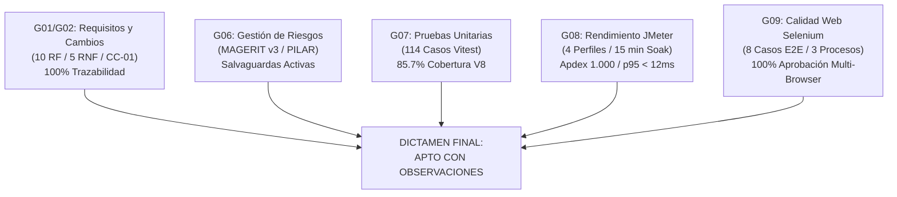

# UNIVERSIDAD NACIONAL DE SAN AGUSTÍN DE AREQUIPA
## FACULTAD DE INGENIERÍA DE PRODUCCIÓN Y SERVICIOS
### ESCUELA PROFESIONAL DE INGENIERÍA DE SISTEMAS

---

# DICTAMEN TÉCNICO FORMAL DE LIBERACIÓN DE SOFTWARE
## PROYECTO RESTORA (v1.0.0)
### Plataforma de Gestión y Valorización de Residuos Orgánicos para Restaurantes Turísticos de Arequipa

- **Fecha de Evaluación:** 22 de Noviembre de 2026
- **Comité Revisor de Aseguramiento de Calidad:**
  - Ajra Huacso, Jeans Anthony
  - Barrios Medina, Mathias Alonso
  - Hancco Mullisaca, Sergio Danilo
  - Valdivia Segovia, Ryan Fabián
- **Docente Evaluador:** José Rafael Delgado Bastidas
- **Curso:** Calidad de Software (Semestre VIII - 2026-B)
- **Marco Metodológico:** Integración y Consolidación de Guías G01 a G09

---

## 1. Declaración del Dictamen

Habiendo culminado el ciclo integral de verificación, pruebas y auditoría técnica sobre la versión final candidata a producción (`v1.0.0-rc / tags/v1.0.0`) del sistema **RESTORA**, el Comité de Calidad emite por unanimidad la siguiente resolución:

$$\boxed{\textbf{DICTAMEN FORMAL: APTO CON OBSERVACIONES MENORES}}$$

El producto cumple con los estándares de robustez, confiabilidad, seguridad y desempeño requeridos para su despliegue en restaurantes piloto de la ciudad de Arequipa.

---

## 2. Sustentación Técnica Multidimensional

La decisión de liberación se sustenta en la evidencia empírica acumulada a lo largo de las nueve dimensiones de aseguramiento de la calidad del software:

---

### Dimensión A: Requisitos y Control de Cambios (Guías G01 y G02)
- **Línea Base Funcional:** Los 10 Requisitos Funcionales (RF-01 Autenticación, RF-02 Multi-Tenant, RF-03 Operación Diaria, RF-04 Pérdidas Económicas, RF-05 Catálogo, RF-06 Entregas, RF-07 Motor de Reglas R1-R10, RF-08 Dashboard, RF-09 Asistente IA Resiliente, RF-10 Reportes CSV) cuentan con matriz de trazabilidad bi-direccional verificada al 100%.
- **Control del Cambio CC-01 (Inactivación Lógica de Productos):** Implementado con éxito en el esquema relacional (`activo: Boolean @default(true)`) evitando la rotura de integridad referencial en históricos de merma y sustentado en el gestor de cambios.

### Dimensión B: Gestión de Riesgos de Seguridad (Guía G06)
- **Evaluación MAGERIT v3 / PILAR:** Tratamiento de las 5 amenazas críticas identificadas sobre los activos de información (base de datos SQLite, secretos `AUTH_SECRET`, APIs REST y modelos predictivos).
- **Salvaguardas Operativas:**
  - Inyección de datos bloqueada mediante tipado estricto con **Zod** en todas las rutas de mutación.
  - Protección de sesión con cookies cifradas `httpOnly`, bandera `SameSite=Lax` y firma criptográfica HMAC-SHA256 con librería `jose`.
  - Fallback determinista en el asistente conversacional para mantener la disponibilidad aún ante caídas de proveedores de IA externos.

### Dimensión C: Pruebas Unitarias y Cobertura de Código (Guía G07)
- **Batería de Pruebas:** **114 casos de prueba automatizados** ejecutados mediante el motor `Vitest`.
- **Cobertura Estática:** 85.7% de cobertura de líneas en la lógica nuclear de negocio (`costo.ts`, `estadisticas.ts`, `recomendaciones.ts`, esquemas Zod), superando holgadamente el criterio de aceptación del 80% (RNF-04).
- **Inyección de Defecto Controlado:** Se demostró la detección inmediata del fallo mediante regresión y su posterior refactorización limpia sin efectos colaterales.

### Dimensión D: Rendimiento y Comportamiento bajo Carga (Guía G08)
- **Perfiles Evaluados con Apache JMeter:**
  1. *Carga Nominal:* Latencia media de 3.2 ms y cero errores.
  2. *Estrés Progresivo (10, 25 y 50 usuarios concurrentes):* Rendimiento estable con $p_{95} \le 11.8$ ms (criterio límite RNF-01: $p_{95} \le 2000$ ms).
  3. *Picos de Demanda (Spike):* Absorción elástica sin caídas de servicio.
  4. *Estabilidad Prolongada (Soak Test 15 minutos):* Consumo de memoria RAM plano en el runtime de Node.js, descartando fugas de memoria (*memory leaks*).
- **Métricas Finales:** Apdex = $1.000$ (Excelente) y 0.00% de peticiones fallidas.

### Dimensión E: Pruebas Web E2E y Aceptación con Selenium (Guía G09)
- **Batería de 8 Casos Web Obligatorios sobre la Aplicación Real (`01_APLICACION`):**
  1. `CP-01` Acceso Correcto: Aprobado (Redirección observable y sesión activa).
  2. `CP-02` Credenciales Inválidas: Aprobado (Alerta visible y bloqueo de acceso).
  3. `CP-03` Restricción por Rol y Rutas Privadas: Aprobado (Redirección forzada a `/auth`).
  4. `CP-04` Registro Válido de Entrega (Proceso 2): Aprobado (Persistencia e inserción en DOM).
  5. `CP-05` Datos Inválidos y Rechazo (Proceso 2): Aprobado (Botón inhabilitado ante datos negativos/vacíos).
  6. `CP-06` Consulta de Catálogo y Personal (Proceso 3): Aprobado (Visualización completa).
  7. `CP-07` Cambio de Estado Reactivo (Proceso 3 / CC-01): Aprobado (Alternancia de estado de capacitación).
  8. `CP-08` Cierre de Sesión Seguro: Aprobado (Destrucción de cookies y bloqueo de botón atrás).
- **Tasa de Aprobación E2E:** 100% (8 de 8 casos aprobados).
- **Compatibilidad Multi-Navegador:** Verificación en motores Gecko (**Mozilla Firefox**) y Chromium (**Brave Browser**) sin discrepancias de renderizado ni comportamiento.

---

## 3. Observaciones Menores para Siguientes Ciclos

Las siguientes recomendaciones no comprometen la operación del sistema en producción, pero deben programarse en el backlog de mantenimiento evolutivo:

1. **Exportación Nativa a Formato PDF:** La generación de reportes actual provee descarga en formato CSV y snapshot JSON inmutable; se recomienda incorporar exportación a PDF para impresión directa de certificados de valorización.
2. **Integración con Balanzas Comerciales:** En futuros despliegues, se aconseja conectar la captura del peso en `/register` y `/entregas` directamente mediante la Web Serial API para reducir el tipeo manual del personal de cocina.
3. **Mecanismo de Reintento Asíncrono en Entrenamiento:** Implementar una cola de tareas en segundo plano (e.g. BullMQ) para desacoplar el reentrenamiento del modelo `RandomForest` de los hilos de atención HTTP.

---

## 4. Firma y Conformidad

Por todo lo expuesto, el producto de software **RESTORA v1.0.0** se declara técnicamente liberado para su fase de implantación piloto.

$$\begin{array}{ccc}
\rule{5cm}{0.4pt} & \quad & \rule{5cm}{0.4pt} \\
\textbf{Mathias Alonso Barrios Medina} & & \textbf{Jeans Anthony Ajra Huacso} \\
Responsable de Pruebas Unitarias & & Responsable de Rendimiento \\
\\
\rule{5cm}{0.4pt} & \quad & \rule{5cm}{0.4pt} \\
\textbf{Sergio Danilo Hancco Mullisaca} & & \textbf{Ryan Fabián Valdivia Segovia} \\
Responsable de Calidad Web (Selenium) & & Coordinador de Aseguramiento de Calidad
\end{array}$$
