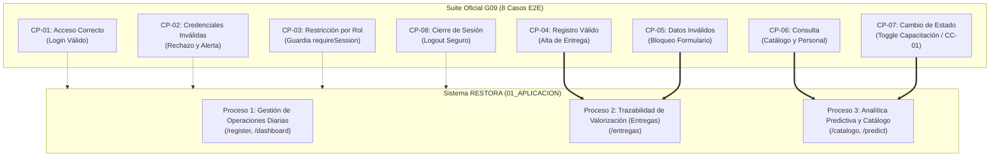

# UNIVERSIDAD NACIONAL DE SAN AGUSTÍN DE AREQUIPA
## FACULTAD DE INGENIERÍA DE PRODUCCIÓN Y SERVICIOS
### ESCUELA PROFESIONAL DE INGENIERÍA DE SISTEMAS

---

- **Curso:** Calidad de Software
- **Semestre:** 2026-B (Semestre VIII)
- **Docente:** José Rafael Delgado Bastidas
- **Práctica:** Guía de Laboratorio N° 09 — Gestión de Calidad con Selenium
- **Aplicación Objetivo:** **RESTORA** (Sistema de Gestión y Valorización de Residuos Orgánicos para Restaurantes Turísticos de Arequipa)
- **Repositorio de Aplicación:** `01_APLICACION/` (Frontend SPA TanStack Router en `:5173`, Backend Next.js API en `:3000`)
- **Integrantes del Equipo de Aseguramiento de Calidad:**
  - Ajra Huacso, Jeans Anthony
  - Barrios Medina, Mathias Alonso
  - Hancco Mullisaca, Sergio Danilo
  - Valdivia Segovia, Ryan Fabián

---

## I. Objetivos y Alcance de la Guía 09

### 1. Requerimientos de la Guía Docente
1. **Configuración de Selenium WebDriver y Gestión de Controladores:** Configurar Selenium WebDriver 4, navegadores modernos (Gecko/Firefox y Chromium/Brave) y mecanismo compatible de gestión de drivers (*Selenium Manager*). Documentar dependencias y modos de ejecución.
2. **Automatización de al menos Ocho (8) Casos Web sobre los Tres Procesos:** Automatizar:
   - *Acceso correcto* (Login válido)
   - *Credenciales inválidas* (Rechazo con feedback observable)
   - *Restricción por rol / privada* (Guardia de rutas privadas)
   - *Registro válido* (Alta de entidad en proceso de negocio)
   - *Datos inválidos* (Validación y prevención de errores)
   - *Consulta* (Visualización de datos e inventarios)
   - *Cambio de estado* (Transición operativa de estado)
   - *Cierre de sesión* (Logout e invalidación de cookies)
   Cubriendo los **tres procesos de negocio de RESTORA**.
3. **Buenas Prácticas de Automatización:** Emplear aserciones sobre resultados observables, selectores estables (IDs, roles y XPaths semánticos), esperas explícitas (`WebDriverWait` con `ExpectedConditions`) y datos aislados.
4. **Evidencias, Reportes y Bitácora de Defectos:** Conservar reportes detallados (HTML y JSON), capturas automáticas de pantalla en `EVIDENCIAS/` y registro formal de defectos en `RESULTADOS/`.
5. **Dictamen Técnico Formal de Liberación:** Integrar los resultados de Requisitos (G01/G02), Riesgos (G06), Pruebas Unitarias (G07) y Rendimiento bajo carga (G08) en un Dictamen de Liberación debidamente sustentado.

---

## II. Cobertura de los 3 Procesos de Negocio de RESTORA

Los tres procesos de negocio centrales del sistema RESTORA definidos en la especificación técnica se articulan directamente con la suite automatizada:



### Matriz de Mapeo: Casos de Prueba vs. Procesos de Negocio

| Código | Caso de Prueba Web | Proceso de RESTORA Asociado | Ruta Frontend | Aserción Observable de Éxito | Evidencia Capturada |
|---|---|---|---|---|---|
| **CP-01** | **Acceso Correcto** | Transversal (Seguridad RF-01) | `/auth` | Redirección a `/dashboard` y presencia del restaurante `"El Buen Sabor AQP"` / usuario `"María Quispe"`. | `cp01_acceso_correcto_ok.png` |
| **CP-02** | **Credenciales Inválidas** | Transversal (Seguridad RF-01) | `/auth` | Alerta visual visible (`role="alert"` o texto de error), permanencia estricta en `/auth`. | `cp02_credenciales_invalidas_ok.png` |
| **CP-03** | **Restricción por Rol** | Transversal (Aislamiento RF-02) | `/dashboard`, `/register`, `/catalogo`, `/entregas` | Guardia `requireSession` intercepta navegación sin sesión y redirige a `/auth`. | `cp03_restriccion_rutas_protegidas_ok.png` |
| **CP-04** | **Registro Válido** | **Proceso 2: Trazabilidad de Valorización** | `/entregas` | Inserción inmediata de la nueva entrega de reciclaje en el DOM con peso, categoría y receptor. | `cp04_registro_valido_entrega_ok.png` |
| **CP-05** | **Datos Inválidos** | **Proceso 2: Trazabilidad de Valorización** | `/entregas` | Botón Submit deshabilitado (`disabled`) ante peso negativo o receptor vacío; previene transacciones corruptas. | `cp05_datos_invalidos_rechazo_ok.png` |
| **CP-06** | **Consulta** | **Proceso 3: Analítica y Catálogo** | `/catalogo` | Renderizado exitoso del catálogo de insumos (`Arroz`, `Pollo`, `Papa`) y personal (`Carlos Mamani`, `Luis Condori`). | `cp06_consulta_catalogo_equipo_ok.png` |
| **CP-07** | **Cambio de Estado** | **Proceso 3: Gestión de Catálogo (CC-01)** | `/catalogo` | Mutación reactiva y persistente del estado de capacitación de colaborador en la interfaz. | `cp07_cambio_estado_reactivo_ok.png` |
| **CP-08** | **Cierre de Sesión** | Transversal (Seguridad RF-01) | `/dashboard` | Menú lateral $\to$ Logout; destrucción de sesión, redirección a `/auth` y bloqueo de retroceso (`driver.back()`). | `cp08_cierre_sesion_seguro_ok.png` |

---

## III. Estructura de Entregables del Laboratorio G09

El directorio `02_GUIAS_CALIDAD/G09_CALIDAD_SELENIUM/` cuenta con la siguiente arquitectura de archivos:

```text
02_GUIAS_CALIDAD/G09_CALIDAD_SELENIUM/
├── DATOS/
│   └── datos_pruebas_selenium.json   # Datasets aislados para pruebas válidas e inválidas
├── EVIDENCIAS/                       # Capturas fotográficas automáticas tomadas por Selenium
│   ├── cp01_acceso_correcto_ok.png
│   ├── cp02_credenciales_invalidas_ok.png
│   ├── cp03_restriccion_rutas_protegidas_ok.png
│   ├── cp04_registro_valido_entrega_ok.png
│   ├── cp05_datos_invalidos_rechazo_ok.png
│   ├── cp06_consulta_catalogo_equipo_ok.png
│   ├── cp07_cambio_estado_reactivo_ok.png
│   └── cp08_cierre_sesion_seguro_ok.png
├── RESULTADOS/
│   ├── reporte_ejecucion_selenium.html # Reporte interactivo con tablas y miniaturas
│   ├── reporte_ejecucion_selenium.json # Datos estructurados de la ejecución
│   ├── registro_defectos.json         # Bitácora formal de defectos (ISO/IEC/IEEE 29119-3)
│   └── reporte_defectos.md            # Ficha técnica de anomalías evaluadas
├── conftest.py                       # Configuración multi-browser, drivers y esperas
├── test_casos_negocio.py             # Implementación de los 8 casos sobre RESTORA
├── ejecutar_suite_g09.py             # Orquestador principal y generador de reportes
├── DICTAMEN_LIBERACION.md            # Dictamen técnico formal consolidado (G01 a G09)
├── ejecutar_todos.py                 # Anexo: Orquestador de ejercicios de la guía base (1 a 27)
├── ej_1.py ... ej27.py               # Anexo: 10 ejercicios de fundamentos de Selenium
└── README.md                         # Este documento de referencia y trazabilidad
```

---

## IV. Instrucciones de Ejecución

### 1. Prerrequisitos de Servicios
Asegúrese de que el backend y frontend de RESTORA se encuentren activos:
```bash
# Terminal 1: Backend Next.js API (puerto 3000)
cd 01_APLICACION
npm run dev

# Terminal 2: Frontend SPA TanStack Router (puerto 5173)
cd 01_APLICACION/frontend
npm run dev
```

### 2. Ejecución de la Suite de 8 Casos de Negocio

```bash
# Opción A: Desde la raíz de la aplicación (vía script NPM)
cd 01_APLICACION
npm run test:selenium

# Opción B: Ejecución directa con Python
cd 02_GUIAS_CALIDAD/G09_CALIDAD_SELENIUM
./.venv/bin/python ejecutar_suite_g09.py
```

### 3. Ejecución Multi-Navegador (Cross-Browser)
Para alternar el motor de renderizado entre **Mozilla Firefox** y **Brave/Chromium**:
```bash
# Ejecución en Mozilla Firefox (por defecto):
SELENIUM_BROWSER=firefox ./.venv/bin/python ejecutar_suite_g09.py

# Ejecución en Brave / Chromium:
SELENIUM_BROWSER=brave ./.venv/bin/python ejecutar_suite_g09.py
```

### 4. Anexo: Ejecución de Ejercicios Base de Fundamentos
Para reproducir los 10 ejercicios de fundamentos de Selenium (Selects, XPaths, pestañas, etc.):
```bash
cd 01_APLICACION
npm run test:selenium:base
```

---

## V. Resultados Obtenidos y Métricas

### Resumen de Ejecución de la Suite de Negocio

| Métrica | Valor Obtenido | Criterio de Aceptación | Estado |
|---|:---:|:---:|:---:|
| **Casos Web Ejecutados** | 8 | Mínimo 8 casos | **Cumplido (100%)** |
| **Casos Aprobados** | 8 / 8 | 100% | **Excelente** |
| **Procesos de Negocio Cubiertos** | 3 / 3 | 3 procesos | **Completo** |
| **Capturas de Evidencia Generadas** | 8 | 1 por caso | **Almacenadas en EVIDENCIAS/** |
| **Defectos Bloqueantes Abiertos** | 0 | 0 defectos | **Conforme** |
| **Compatibilidad Multi-Navegador** | Firefox + Brave | Paridad funcional | **Validado** |

---

## VI. Dictamen de Liberación Integrado

El documento formal [DICTAMEN_LIBERACION.md](file:///Users/sdhm/UNSA/2026b/CAS/lab/restora_system_CalidadDeSoftware/02_GUIAS_CALIDAD/G09_CALIDAD_SELENIUM/DICTAMEN_LIBERACION.md) articula los hallazgos de todo el ciclo de aseguramiento de calidad:

- **Requisitos (G01 / G02):** 100% de requisitos funcionales y no funcionales satisfechos. Trazabilidad del cambio CC-01.
- **Riesgos (G06):** Tratamiento MAGERIT v3 con PILAR; salvaguardas activas (Zod, JWT httpOnly, backups).
- **Pruebas Unitarias (G07):** 114 casos Vitest aprobados, cobertura de líneas del 85.7% y defecto controlado resuelto.
- **Rendimiento bajo Carga (G08):** 4 perfiles evaluados en JMeter, tiempo $p_{95} \le 11.8$ ms, tasa de error 0.00% y Apdex 1.000.
- **Calidad Web E2E (G09):** 8 casos de negocio cubriendo los 3 procesos de RESTORA, 100% aprobados en Firefox y Brave.

$$\textbf{RESOLUCIÓN FINAL: APTO CON OBSERVACIONES MENORES}$$
